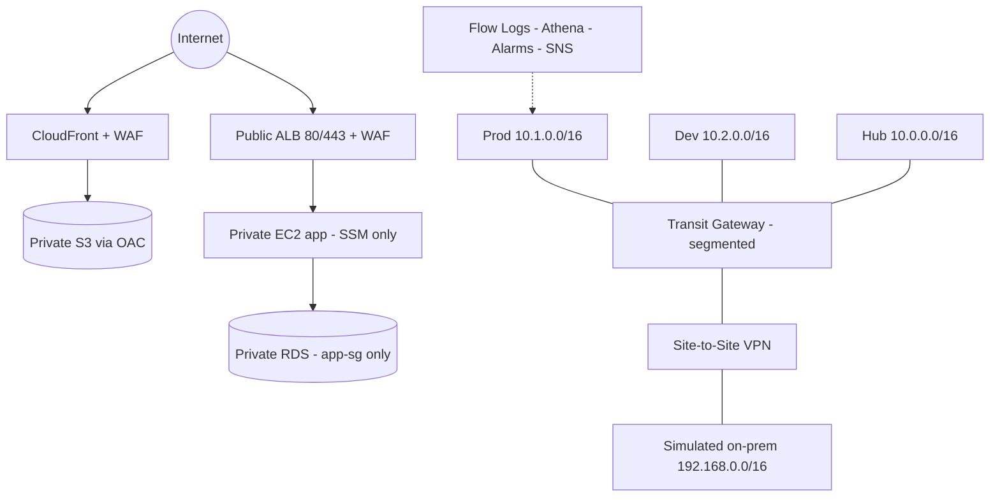

# Secure AWS Network Architecture & Hybrid Connectivity

Portfolio + learning project: secure segmented AWS network, simulated hybrid connectivity, edge protection, monitoring & IR.
**On-prem is SIMULATED** (a separate VPC with a strongSwan gateway) — no real corporate network, no physical Direct Connect.

## Architecture



## IP plan summary

| VPC | CIDR |
|-----|------|
| Hub / shared-services | `10.0.0.0/16` |
| Prod | `10.1.0.0/16` |
| Dev | `10.2.0.0/16` |
| Simulated on-prem | `192.168.0.0/16` |

Each VPC: 2 AZs, public / private-app / private-data / TGW-attach (/28) tiers. Details: [`docs/ip-plan.md`](docs/ip-plan.md).

## Prerequisites

- Terraform >= 1.6, AWS CLI v2, an AWS account + CLI profile (see manual steps), S3+DynamoDB backend (run `scripts/bootstrap-state-backend.sh`).
- No real credentials/account IDs/domains/IPs in git — placeholders only (`111111111111`, `example.com`, `203.0.113.0/24`).

## Deployment order (one week at a time, destroy after evidence)

```bash
bash scripts/bootstrap-state-backend.sh   # once per account
cd terraform/environments/week1-core && cp terraform.tfvars.example terraform.tfvars
terraform init && terraform validate && terraform plan -out w1.tfplan && terraform apply w1.tfplan
bash scripts/tests/test-connectivity.sh
# ... capture evidence, then terraform destroy before next week
# week2-hybrid -> test-vpn-and-routing.sh -> destroy
# week3-edge -> test-edge-protections.sh -> destroy
# week4-monitoring -> IR drill -> destroy
```

`terraform/environments/full` composes everything with `enable_*` toggles (all expensive/optional default OFF).

## Test scripts

| Script | Covers |
|--------|--------|
| `scripts/tests/test-connectivity.sh` | ALB->app, app->DB, NAT egress + NEGATIVE (dev->prod, internet->DB, SSH) |
| `scripts/tests/test-vpn-and-routing.sh` | Tunnel telemetry + on-prem sim reachability |
| `scripts/tests/test-edge-protections.sh` | S3 denied / CF OK / WAF SQLi / headers / TLS |
| `scripts/tests/test-segmentation.sh` | Isolation expectations template |
| `scripts/ir/*.sh` | IR drill: simulate (safe) -> isolate -> collect -> restore |

## 4-week roadmap (deliverable -> file)

| Week | Theme | Deliverables -> files |
|------|-------|----------------------|
| 1 | VPC Core Architecture | VPC/subnet plan [`docs/ip-plan.md`](docs/ip-plan.md), EC2/ALB/RDS (`terraform/modules/{vpc,ec2-app,alb,rds}`), SG/NACL [`docs/security-groups-nacl-rules.md`](docs/security-groups-nacl-rules.md), diagram [`docs/architecture.md`](docs/architecture.md), tests [`docs/connectivity-test-results.md`](docs/connectivity-test-results.md), guide [`docs/week1-vpc-core.md`](docs/week1-vpc-core.md) |
| 2 | Advanced Connectivity & Hybrid | TGW diagram [`docs/architecture.md`](docs/architecture.md), peering/endpoints (`terraform/modules/{vpc-peering,vpc-endpoints,privatelink}`), VPN (`terraform/modules/site-to-site-vpn` + `onprem-simulator`), routes [`docs/routing-documentation.md`](docs/routing-documentation.md), hybrid report [`docs/hybrid-connectivity-test-report.md`](docs/hybrid-connectivity-test-report.md), comparison [`docs/connectivity-options-comparison.md`](docs/connectivity-options-comparison.md), DX concepts [`docs/direct-connect-concepts.md`](docs/direct-connect-concepts.md), guide [`docs/week2-hybrid-connectivity.md`](docs/week2-hybrid-connectivity.md) |
| 3 | Edge Security, WAF, DDoS & CDN | CF+S3 lab [`docs/edge-architecture.md`](docs/edge-architecture.md), WAF (`terraform/modules/{waf-cloudfront,waf-alb}`), DDoS plan [`docs/ddos-mitigation-plan.md`](docs/ddos-mitigation-plan.md), R53/health [`docs/route53-healthcheck-design.md`](docs/route53-healthcheck-design.md), GA vs CF [`docs/global-accelerator-vs-cloudfront.md`](docs/global-accelerator-vs-cloudfront.md), FM concepts [`docs/firewall-manager-concepts.md`](docs/firewall-manager-concepts.md), guide [`docs/week3-edge-security.md`](docs/week3-edge-security.md) |
| 4 | Monitoring, Detection & IR | Flow queries [`docs/flow-log-queries.md`](docs/flow-log-queries.md) + [`analysis/athena/`](analysis/athena/), detections [`docs/detection-use-cases.md`](docs/detection-use-cases.md), IR runbook [`docs/incident-response-runbook-compromised-instance.md`](docs/incident-response-runbook-compromised-instance.md), evidence [`docs/evidence-collection-notes.md`](docs/evidence-collection-notes.md), final report [`docs/final-secure-network-report.md`](docs/final-secure-network-report.md), guide [`docs/week4-monitoring-ir.md`](docs/week4-monitoring-ir.md) |

## Cost warnings

NAT Gateway, TGW attachments, VPN connections, Client VPN associations, ALB, RDS, Global Accelerator, WAF, Traffic Mirroring, and Interface Endpoints bill per-hour / per-GB. See [`docs/cost-guardrails.md`](docs/cost-guardrails.md). Deploy one week at a time; `bash scripts/cleanup.sh` after evidence.

## Cleanup

```bash
bash scripts/cleanup.sh
# reverse order destroy per env; verify no NAT/TGW/VPN/GA/Client-VPN left in console.
```

## Security notice

- Least privilege, SSM-only admin (no SSH/RDP from internet), SG-to-SG refs, stateless NACLs with ephemeral rules, KMS + TLS everywhere.
- NEVER commit `*.tfvars` with real values, state files, `.pem`, or real ARNs/domains. CI runs fmt/validate/tflint/checkov/gitleaks/shellcheck with NO AWS credentials and NO apply.
