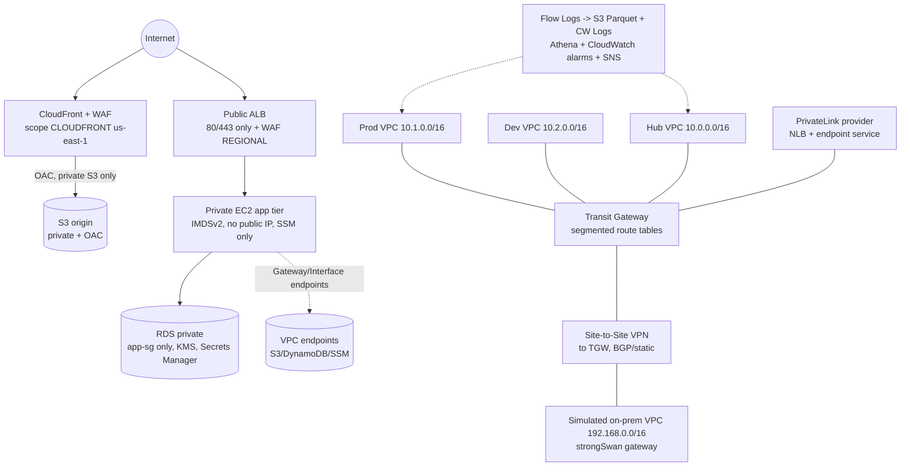
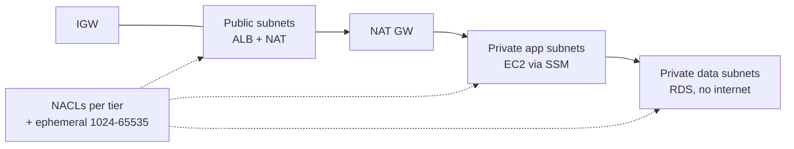
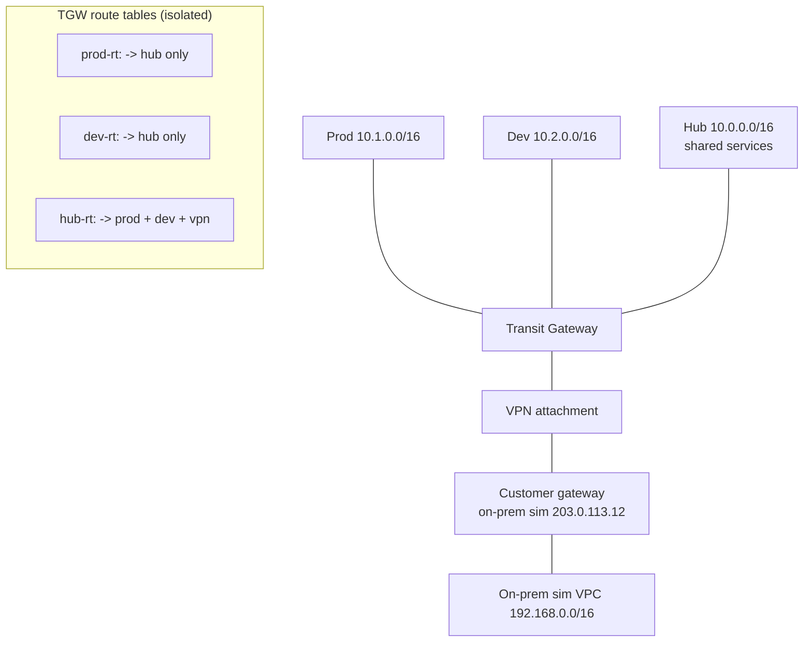
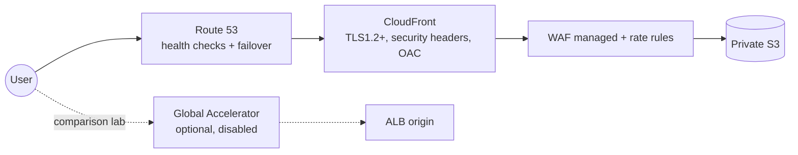
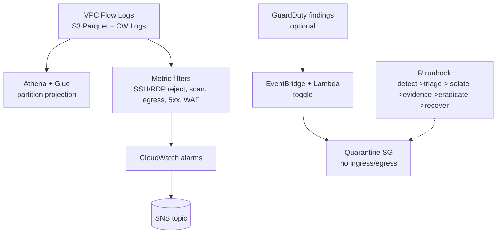

# Architecture

## Overall architecture

## Week 1 — VPC core

## Week 2 — Hub-and-spoke TGW + hybrid VPN

> Peering is non-transitive (week2 lab). TGW solves transitive hub-and-spoke. Prod <-> Dev is BLOCKED by design.

## Week 3 — Edge / CloudFront

## Week 4 — Monitoring / IR flow

