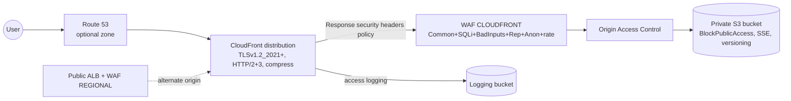

# Edge Architecture

- S3 bucket policy allows ONLY the CloudFront service principal + distribution ARN (OAC). Direct S3 website/REST access = DENIED (tested in `test-edge-protections.sh`).
- Geo restriction variable (`none` default; `whitelist/blacklist` optional).
- Logging: CloudFront access logs + WAF logs (redacted fields) + S3 server access.
